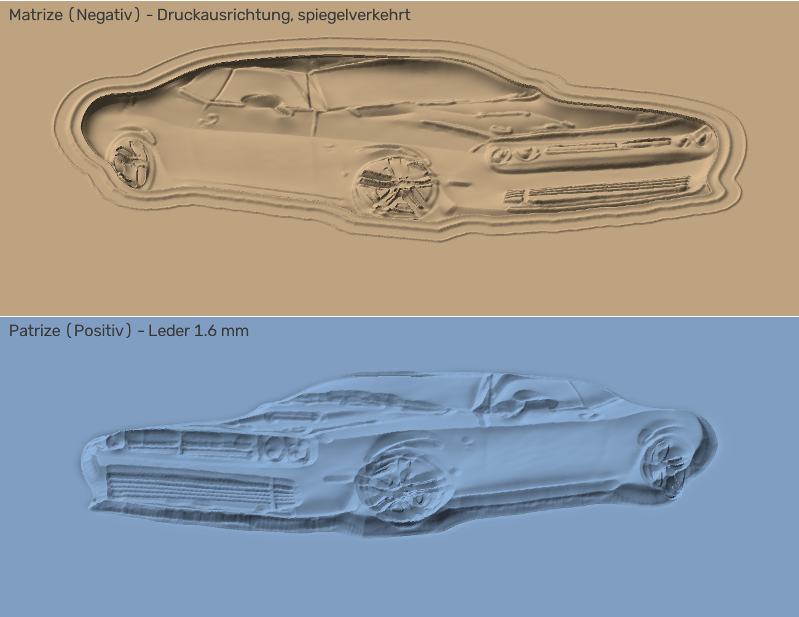

# 3D-Modelle

Sammlung reproduzierbarer 3D-Druckmodelle. Jedes Modell enthält Vorlage, Generator, Druckdateien
und Anleitung.

| Modell | Beschreibung | Drucker |
|---|---|---|
| [leder-praegung-auto](leder-praegung-auto/ANLEITUNG.md) | Leder-Prägewerkzeug (Matrize und Patrize) für einen Muscle-Car-Schlüsselanhänger, abgeleitet aus einem Foto | Bambu Lab P2S |
| [logo-anhaenger-popko](logo-anhaenger-popko/ANLEITUNG.md) | Popko-Design Logo als Prägewerkzeug: Gesamtlogo 60 × 30 mm und PKD-Emblem Ø 45 mm | Bambu Lab P2S |



## Schnellstart
```bash
pip install -r requirements.txt
python3 leder-praegung-auto/generator/generate.py
python3 leder-praegung-auto/generator/check.py
python3 logo-anhaenger-popko/generator/generate.py
python3 logo-anhaenger-popko/generator/check.py
```

Der gemeinsame Werkzeugbau (Matrize, Patrize, Netz, Prüfungen) liegt in `gemeinsam/`.

Projektregeln für KI-Assistenten stehen in [CLAUDE.md](CLAUDE.md) bzw. [AGENTS.md](AGENTS.md),
den aktuellen Stand findest du in [PROJEKTSTATUS.md](PROJEKTSTATUS.md), die Begründungen in
[ENTSCHEIDUNGEN.md](ENTSCHEIDUNGEN.md).
