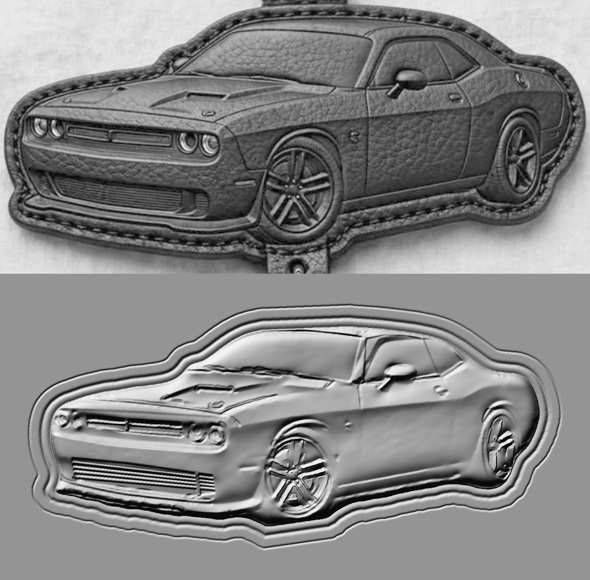

# Leder-Prägewerkzeug „Muscle-Car-Patch“ – Anleitung

Prägewerkzeug-Satz aus Matrize (Negativ) und Patrize (Positiv), abgeleitet aus `quelle/foto.jpg`.
Gepresst entsteht ein **erhabenes Auto-Relief wie auf dem Foto** – inklusive Nahtrille und
Schnittkante für den Zuschnitt.



## 1. Dateien

| Datei | Zweck |
|---|---|
| `Matrize_Negativ_90mm.3mf` / `.stl` | **Negativ.** Liegt auf der Narbenseite (Sichtseite) und trägt alle Details. Im Druckbild spiegelverkehrt – das ist richtig. |
| `Patrize_Positiv_90mm_Leder-1.2mm.3mf` / `.stl` | **Positiv** für Leder 1,0–1,4 mm |
| `Patrize_Positiv_90mm_Leder-1.6mm.3mf` / `.stl` | **Positiv** für Leder 1,4–1,8 mm (Standard, z. B. 4 oz) |
| `Patrize_Positiv_90mm_Leder-2.0mm.3mf` / `.stl` | **Positiv** für Leder 1,8–2,2 mm |
| `schnittschablone_1zu1.svg` | Kontur, Stichlinie und Zuschnitt 1:1 (Papier oder Laser) |
| `vorschau_*.png`, `pruefbericht.json` | Vorschauen und automatischer Prüfbericht |

Du brauchst **eine Matrize + die eine Patrize, die zu deiner Lederstärke passt**.

Dass die Patrize weicher und weniger detailliert aussieht als die Matrize, ist Absicht. Sie
drückt das Leder nur von hinten in die Form. Die feinen Details (Fugen, Scheinwerfer, Lamellen,
Nahtrille) prägt die Matrize auf der Sichtseite.

Maße: Patch 90 × 41 mm (wie auf dem Foto, geschätzt über das Größenverhältnis zum
Anhänger-Schild), Platten 126 × 78 mm, Lederzuschnitt **100 × 52 mm**.
Reliefhöhe bis 2,4 mm, Fugen und Rillen 0,2–0,3 mm tief und mindestens ca. 0,45 mm breit.

## 2. Drucken auf der Bambu Lab P2S

Die Teile liegen bereits richtig auf dem Druckbett (Relief nach oben). Bitte **nicht skalieren**:
Lederspalt, Stifte und Bohrungen sind auf die Lederstärke abgestimmt. Für eine andere Größe das
Modell neu erzeugen (siehe Abschnitt 6).

| Einstellung | Empfehlung |
|---|---|
| Material | PLA (steif und maßhaltig). PETG geht auch, ist aber etwas nachgiebiger. |
| Düse | 0,4 mm reicht. Mit der 0,2-mm-Düse werden Speichen und Lamellen noch schärfer. |
| Schichthöhe | **0,08 mm** (Profil „0.08mm Extra Fine“), wahlweise mit variabler Schichthöhe |
| Wände / oben / unten | 4 Wände, 6 obere und 4 untere Schichten |
| Füllung | **100 %** (am stabilsten), mindestens 60 % Gyroid |
| Stützstrukturen, Rand | keine |
| Bügeln (Ironing) | **aus** – das würde Rillen und Kanten verschmieren |

Nach dem Druck: Die Stifte sollten leicht in die Sacklöcher der Matrize gleiten (0,25 mm Spiel).
Wenn sie klemmen, die Stifte kurz mit Schleifpapier (Körnung 400) abziehen.

## 3. Leder vorbereiten

1. **Pflanzlich gegerbtes Leder** (Blankleder oder Formleder) verwenden. Chromgegerbtes Leder
   behält die Prägung nicht.
2. Zuschnitt **100 × 52 mm**, damit das Stück zwischen die vier Stifte passt.
3. Anfeuchten („casing“): mit einem Schwamm gleichmäßig nass machen, bis das Leder durchgefeuchtet
   ist. Dann 10–20 Minuten warten, bis die Oberfläche fast wieder ihre trockene Farbe hat.

## 4. Prägen

1. Die Patrize mit dem Relief nach oben auf eine feste Unterlage legen.
2. Das Leder **mit der Narbenseite nach oben** mittig zwischen die Stifte legen. Die Fahrzeugfront
   liegt auf der Seite des dicken Stifts (Ø 8 mm).
3. Die Matrize **mit dem Gesicht nach unten** aufsetzen. Das große Loch kommt über den dicken
   Stift, falsch herum passt sie nicht.
4. Gleichmäßig pressen, bis die Matrize auf den vier Anschlagringen aufliegt. Geeignet sind eine
   Kniehebel- oder Hydraulikpresse oder ein Schraubstock bzw. Zwingen. Oben und unten jeweils eine
   ebene Stahl- oder Hartholzplatte unterlegen, damit sich der Druck verteilt.
5. 15–30 Minuten gepresst lassen. Die Form hält am besten, wenn das Leder im Werkzeug fast
   trocknet (einige Stunden).
6. Herausnehmen und 24 Stunden trocknen lassen. **Nicht heiß trocknen**: PLA wird ab etwa 55 °C
   weich, also das Werkzeug nie in heißes Wasser, den Backofen oder unter einen Föhn halten.
7. An der geprägten Schnittkante ausschneiden, die Kanten bearbeiten und entlang der Nahtrille
   nähen. Wie auf dem Foto lässt sich ein Rückenteil aufnähen und die Schlüssellasche
   dazwischenlegen. Die Hohlräume auf der Rückseite können vorher hinterfüttert werden.

**Ohne Patrize:** Das Leder mit der Narbenseite nach unten in die Matrize legen, dahinter eine
3–5 mm starke Hartgummi- oder EVA-Platte legen und pressen. Die Details werden gut, große Formen
etwas weicher.

## 5. Wenn es nicht gleich klappt

| Problem | Abhilfe |
|---|---|
| Prägung zu flach | Leder feuchter machen, länger pressen, oder die Patrize der nächstdünneren Lederstärke nehmen |
| Leder an Kanten gequetscht oder eingerissen | weniger nass, langsamer pressen, oder die Patrize der nächstdickeren Lederstärke nehmen |
| Wasserflecken oder Glanzstellen | gleichmäßiger anfeuchten, Werkzeug sauber und trocken halten |
| Stifte klemmen | Stifte leicht anschleifen, Löcher entgraten |

Vorher am besten an einem Reststück testen.

## 6. Neu erzeugen und anpassen (optional)

```bash
pip install -r ../requirements.txt
python3 generator/generate.py                         # Standard: 90 mm, Leder 1,2 / 1,6 / 2,0 mm
python3 generator/generate.py --laenge 110 --leder 1.8
python3 generator/check.py                            # Ausgabedateien unabhängig prüfen
```

Weitere Parameter (Plattenstärke, Spaltfaktor, Anschlaghöhe, Stifte) stehen in
`gemeinsam/dies.py` in der Klasse `DieParams`, die Reliefgestaltung in `generator/relief.py`.

## Hinweis zu Rechten

Die Form des Fahrzeugs kann durch Design- oder Markenrechte des Herstellers geschützt sein.
Für den privaten Gebrauch ist das unkritisch. Vor einem gewerblichen Verkauf bitte die Rechtelage
klären.
