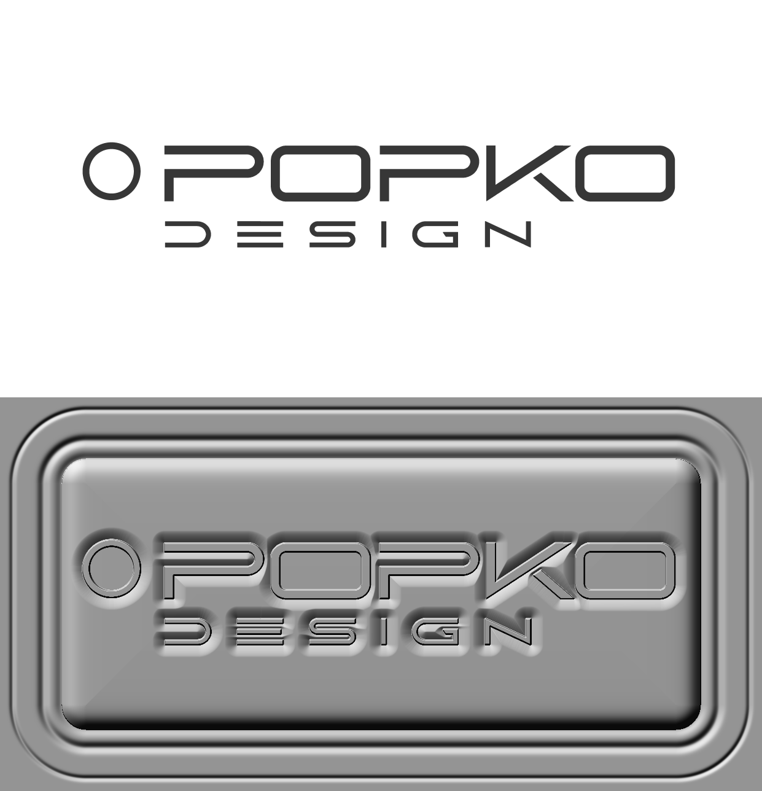

# Popko-Design Logo-Anhänger – Anleitung

Zwei Prägewerkzeug-Sätze (Matrize + Patrize) aus `quelle/popko_design_logo_pfade.svg`:

| Form | Anhänger | Motiv | Ordner |
|---|---|---|---|
| **Gesamtlogo** | 60 × 30 mm, abgerundet (R 6 mm) | Ring, POPKO, DESIGN (48,5 × 8,8 mm) | `ausgabe/logo/` |
| **PKD-Emblem** | rund, Ø 45 mm | Ring Ø 33 mm mit P, K, D (je 5,4 mm hoch) | `ausgabe/emblem/` |



## Machart

- **Nahtrand** mit Stichrille (2,5 mm vom Rand) und geprägter Schnittkante.
- **Gepolstertes Feld** in der Mitte, etwa 1 mm hoch, wie beim Auto-Anhänger.
- **Logo erhaben:** Das Logo bleibt auf Feldhöhe stehen. Rundherum drückt die Matrize das Leder
  abgeschrägt ein (0,38 mm tief, wie beim Punzieren). Kleine Innenräume (O, P, D, kleiner Ring)
  werden ganz eingedrückt.
- **Die Patrize ist ein glattes Kissen. Das ist Absicht:** So feine Linien lassen sich von hinten
  nicht formen. Das gesamte Logo prägt die Matrize auf der Sichtseite.
- **Größe des Logos:** Es ist etwa 5,6-mal so breit wie hoch. Deshalb ist der Anhänger 60 × 30 mm
  groß, so wird das Logo am größten.

**Was gegenüber der Vorlage angepasst ist:**
- **„DESIGN“** im Gesamtlogo: Die Striche wären nur 0,34 mm dick. Sie sind leicht auf 0,40 mm
  verstärkt, damit sie sich mit der 0,4-mm-Düse drucken lassen. Die Lücken im E bleiben dabei
  etwa 0,4 mm breit.
- **„PKD“ im kleinen Ring** des Gesamtlogos: Die Buchstaben wären dort nur 0,7 mm hoch und sind
  weder druck- noch prägbar. Deshalb gibt es dort nur den Ring, und das Emblem hat eine eigene,
  große Form.
- **Ring:** Seine Strichstärke folgt den feinen Buchstaben (Gesamtlogo 0,55 mm, Emblem 0,85 mm).
- **Gold-Akzente** (E und D) gehen beim Prägen nicht verloren, werden aber nicht farbig. Für Farbe
  nach dem Prägen mit Lederfarbe, Goldpaste oder Heißfolie nacharbeiten.

## Dateien je Ordner

- `…_Matrize_Negativ_….3mf` / `.stl`: Sichtseite, **spiegelverkehrt** (das ist richtig).
- `…_Patrize_Positiv_…_Leder-1.2mm / 1.6mm / 2.0mm`: Nimm die Patrize, die zu deiner Lederstärke
  passt.
- `schnittschablone_1zu1.svg`: Kontur, Stichlinie und Lederzuschnitt im Maßstab 1:1.
- `vorschau_*.png`, `pruefbericht.json`: Vorschauen und automatischer Prüfbericht.

**Lederzuschnitt:** Gesamtlogo 68 × 38 mm, Emblem 53 × 53 mm.
**Platten:** Gesamtlogo 94 × 64 mm, Emblem 79 × 79 mm.

## Drucken (Bambu Lab P2S)

Es gelten dieselben Einstellungen wie beim Auto-Anhänger, siehe
[`../leder-praegung-auto/ANLEITUNG.md`](../leder-praegung-auto/ANLEITUNG.md): PLA, 0,08 mm
Schichthöhe, 100 % Füllung, keine Stützen, Bügeln aus, nicht skalieren.
Für das Gesamtlogo bringt die **0,2-mm-Düse** sichtbar schärfere „DESIGN“-Buchstaben. Für das
Emblem reicht die 0,4-mm-Düse.

## Leder und Prägen

- **Empfehlung:** pflanzlich gegerbtes Leder mit **1,6 mm**. Die Verdichtung an der Abschrägung
  liegt dann bei 40 %. 1,2 mm geht auch, liegt mit 49 % aber an der Grenze. 2,0 mm ergibt
  weichere Kanten.
- **Ablauf** wie beim Auto-Anhänger:
  1. Leder anfeuchten.
  2. Patrize nach oben hinlegen, das Leder mit der Narbenseite nach oben darauf.
  3. Matrize mit dem Gesicht nach unten aufsetzen. Der dicke Stift sorgt für die richtige Lage.
  4. Pressen bis auf die Anschlagringe und 15–30 Minuten gepresst lassen.
  5. Trocknen lassen, an der Schnittkante ausschneiden und nähen.
- **Druck:** Für eine scharfe Abschrägung braucht das Gesamtlogo etwas mehr Druck als das
  Auto-Motiv. Am besten nimmst du einen Schraubstock oder eine Kniehebelpresse und legst ebene
  Platten unter. Vorher an einem Reststück testen.

## Neu erzeugen (optional)

```bash
python3 generator/generate.py                       # beide Formen, Leder 1,2 / 1,6 / 2,0 mm
python3 generator/generate.py --variante emblem --leder 1.6
python3 generator/check.py                          # Ausgabedateien unabhängig prüfen
```

Größen und Gestaltung (Anhängermaß, Logobreite, Strichstärken, Abschrägung) stehen in
`generator/generate.py` (`VARIANTEN`) und `generator/logo.py` (`TagDesign`).

**Hinweis:** Die SVG muss die Schrift als Pfade enthalten (Inkscape: Pfad → Objekt in Pfad
umwandeln), weil die Schrift „abnes“ auf anderen Rechnern fehlt.
